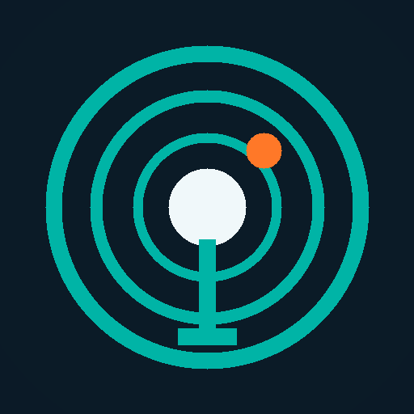

# Deck Live

A Decky Loader plugin that lets you live stream Game Mode gameplay to **YouTube** or **Twitch** from the Quick Access menu, without switching to Desktop Mode — plus **Game Help** YouTube guides for the game you are playing.

## Features
- Platform picker (YouTube, Twitch) with a masked stream-key field. Keys are stored locally only (`settings.json`, mode 600), redacted from logs, and never passed on a command line.
- Presets: 720p30, 720p60, 1080p30, **1080p60 (default)**, 1200p60 (16:10). Wider or taller screens are letterboxed, never stretched.
- Hardware H.264 through VA-API (`vah264enc`), falling back to `vaapih264enc`, then `openh264enc`, then `x264enc`.
- Game audio from the default output's monitor, plus an optional mic (off by default) with WebRTC noise suppression. Separate game-volume and mic-gain sliders.
- A/V sync offset slider (−500…+500 ms; default −160 ms, tuned on Legion Go).
- Live status, uptime, and health (fps, kbps, dropped/duplicated frames, stall warnings).
- **Auto-reconnect**: after an unexpected drop it retries after 2, 5, 10, 20, then every 30 s, for up to 5 min. The panel shows "Reconnecting (n)…" and uptime is kept. Stop cancels.
- **Run Diagnostics**: records a 20 s test to `~/Videos/decky-live-test.flv` without going live. It reports capture node, encoder, audio sources and level, frames vs expected, stalls, and file length vs wall-clock time.
- **Game Help**: while a game is running, search YouTube for walkthroughs, boss guides, achievement guides, handheld best settings, or a custom query. Locked Steam achievements can be picked for targeted guides. Results open in the Steam overlay browser (press B to return).

## Game Help details
- **YouTube API key (optional):** your own YouTube Data API v3 key, set in *Game Help settings*. Stored locally (mode 600) and never logged. Deck Live stops API search at 90 calls/day (below Google’s default 100) and switches to no-key mode until midnight PT.
- **No-key mode:** uses `yt-dlp` on `PATH`, or a user-initiated download of the pinned 2026.08.19 zipapp kept only when its SHA256 matches the published release checksum.
- **Caching:** 7 days per query; offline serves stale cache with an OFFLINE badge.
- **Pinned channel:** defaults to VetTV Handheld (`UCTf3fhasLYzcP4LmSOd6mIw`); change or clear it in settings. Matching pinned videos sort first.
- Prefetch: when a game starts, a default walkthrough search is warmed into cache after a short delay (does not interrupt streaming).

## Requirements
- Decky Loader (API v1) in Game Mode (gamescope exposes the PipeWire video node `gamescope`).
- PipeWire with pipewire-pulse (`pactl`, `pw-dump`).
- GStreamer (tested with 1.28; 1.20+ likely needed for the `va` plugin) with `gst-launch-1.0`, `gst-inspect-1.0` and these elements: `pipewiresrc`, `pulsesrc`, `vapostproc`, `vah264enc` (or one of the fallback encoders), `h264parse`, `videorate`, `avenc_aac` (or `fdkaacenc`), `flvmux`, `rtmp2sink`. `level` and `webrtcdsp` are optional.
- Required for streaming: system `python3` and GStreamer with the elements above. When PyGObject (`gi`, package `python3-gobject`) and the GStreamer typelibs are available, the worker reads the pipeline, including the stream key, from stdin. Otherwise, a protected `gst-launch-1.0` runner reads the pipeline over stdin and disables ptrace access before exec, preventing other local users from reading the key from `/proc/<pid>/cmdline`; health stats are unavailable in this mode. Go Live is refused if the system cannot protect the process arguments.
- Game Help (optional): network access; optional YouTube API key; optional `yt-dlp`.

## Tested devices
| Device | OS | Result |
|---|---|---|
| Lenovo Legion Go | Bazzite (GStreamer 1.28.8) | ✅ 1080p60 to YouTube, smooth, in sync at −160 ms |
| Steam Deck LCD/OLED | SteamOS Stable/Beta/Preview | ❓ needs store-review testing (gst-launch path supports systems without PyGObject) |

## Install

### Option 1: installer script (recommended, no developer mode)
In Desktop Mode, open **Konsole** and run:

    curl -L https://github.com/VetTV-Studios/deck-live/raw/main/install.sh | sh

It checks that Decky Loader is installed and downloads the latest release. It then replaces `~/homebrew/plugins/Deck Live` atomically and restarts Decky (`sudo systemctl restart plugin_loader`). Run it again any time to update.
> **The installer needs your sudo password.** `~/homebrew/plugins` is owned by root, so the script asks for it.
> - **SteamOS (Steam Deck):** the `deck` user has no password by default. If you've never set one, open **Konsole** in Desktop Mode and run `passwd` first, then run the installer.
> - **Bazzite:** use your normal account password.

To uninstall:

    curl -L https://github.com/VetTV-Studios/deck-live/raw/main/uninstall.sh | sh            # keeps settings and stream keys
    curl -L https://github.com/VetTV-Studios/deck-live/raw/main/uninstall.sh | PURGE=1 sh    # also deletes settings and keys

### Option 2: ZIP + Decky developer mode
1. Download the zip from the [latest release](https://github.com/VetTV-Studios/deck-live/releases/latest).
2. Decky → Settings (gear) → General → enable **Developer mode**.
3. Decky → Settings → **Developer** → **Install Plugin from ZIP**, then pick the zip. (Or use **Install Plugin from URL** with `https://github.com/VetTV-Studios/deck-live/releases/latest/download/deck-live.zip`.)

### Option 3: Decky Plugin Store
After the Plugin Database PR is merged, install from Decky → Store → search **Deck Live**. See [`STORE.md`](STORE.md) for the submission checklist.

## Usage
1. Open Quick Access, then Deck Live.
2. Choose a platform, paste the stream key, and tap Save Key.
3. Choose a preset (optional), and tap **Go Live**.
4. Use **Run Diagnostics** first if anything looks wrong.
5. With a game running, use **Game Help** to pick a topic or search, then open a video in the overlay browser.

## Build
    pnpm install && pnpm build
    ./package.sh        # -> ./deck-live.zip (streaming workers + gamehelp + store icon)

    pnpm test           # Python unit suite
    # CI also runs: frontend build, search-game TS test, shellcheck

## How it works
`main.py` (the Decky backend) builds a GStreamer pipeline and runs it in `gst_worker.py` (system python3 + PyGObject) when available. Otherwise, it starts `gst-launch-1.0` through `gst_launch_worker.py`; that runner reads the pipeline from stdin and disables ptrace access before exec, preventing other local users from reading the key from `/proc/<pid>/cmdline`:

    pipewiresrc(gamescope, always-copy) → leaky queue → vapostproc (GPU scale, add-borders)
      → videorate (CFR) → vah264enc (CBR, 2 s GOP, no B-frames) → h264parse → [video delay = −A/V offset]
    pulsesrc(<default sink>.monitor) [+ mic → webrtcdsp] → audiomixer → [audio delay = +A/V offset] → AAC 160k
      → flvmux(streamable) → rtmp2sink (async-connect, sync=false)

The worker reports stats as JSON on stdout. The backend forwards them to the panel and logs them every 10 s (Decky plugin log under `~/homebrew/logs/`).

Game Help (`gamehelp.py`) searches YouTube via the Data API or yt-dlp, caches in SQLite under the plugin runtime dir, and never blocks the streamer event loop for network I/O.

## Ingest URLs
| Platform | URL |
|---|---|
| YouTube | rtmps://a.rtmps.youtube.com:443/live2 |
| Twitch | rtmp://ingest.global-contribute.live-video.net/app (Twitch's auto/global ingest) |

Kick, Facebook and Rumble can be re-enabled later via `PLATFORMS` and `ENABLED_PLATFORMS` in `main.py`.

## Known limitations
- One destination at a time; no multistream.
- Twitch uses the global ingest, not the nearest regional server. Twitch video is capped at 6000 kbps CBR (1080p60/1200p60 6000, 1080p30 and 720p60 4500, 720p30 3000) with a 1 s VBV/CPB buffer, 2 s keyframes and no B-frames. YouTube keeps the full preset bitrates.
- Gamescope only sends frames when the screen changes. Static scenes are filled with duplicates, which is expected.
- Changing audio output (for example plugging in headphones) mid-stream keeps capturing the old device until a reconnect or restart.
- No bitrate adaptation; on weak uplinks use 720p.
- Steam Deck SteamOS store testing still required for Plugin Database approval.
- Game Help needs network; without an API key or yt-dlp, search cannot fetch new results (cached results still work offline).

## License
BSD-3-Clause. See `LICENSE`.
